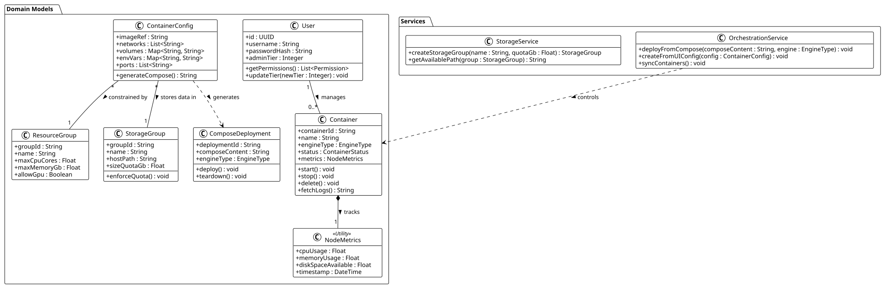

# Project Overview

**Project Title:** SysMon  
**Target Audience:** Homelab enthusiasts and small-sized businesses
wanting to utilize their own infrastructure.  
**Goal:** To deliver a seamless user experience similar to Web UIs from
enterprise solutions (Azure/AWS), allowing both technical and
non-technical users to monitor, maintain, and build on private
infrastructure.

## Core Modules

1.  **Frontend:** User Interface for visualization, configuration, and
    monitoring.

2.  **Backend:** Orchestration of tasks, container management, telemetry
    aggregation, and host-level filesystem management.

3.  **Authentication System:** Tier-based access control (Tier 1 to
    Tier 3) for secure team collaboration.

# Key Features

- **Container Orchestration:** Support for both Docker and Podman.
  Features manual container creation via Compose files, alongside a
  visual UI builder that auto-generates Compose files.

- **Resource Governance (Compute Groups):** Tier 1 admins can create
  profiles limiting compute resources (e.g., thread limits, RAM caps,
  GPU access restrictions) enforced at the cgroup level via Compose
  deployments.

- **Storage Quotas (Storage Groups):** Provisioning of bounded host
  directories for container bind-mounts. Ensures specific user groups
  cannot exceed predetermined disk space limits.

- **Network Management:** Creating profiles, static/dynamic IP
  allocation, and a firewall rules manager.

- **Telemetry & Monitoring:** Real-time visualization of Memory
  utilization, CPU utilization, and Disk space.

## Feature Priorities

- **Must have:**

  - **Support for either Docker or Podman:** SysMon is meant to act as a
    wrapper of a different system, equating support with basic
    functionality.

  - **Functional Compute Groups:** Enforceable resource access rules
    are mandatory in a team-based environment.

  - **Functional Storage Groups:** As with Compute Groups, lacking this
    functionality introduces potential security risks.

- **Should have:**

  - **Support for both Docker and Podman:** Versatility is supposed to
    be SysMon's main selling point - supporting both tools delivers on
    it.

  - **Container creation through Compose files:** Requiring the user to
    access the underlying system directly to create containers is
    counterintuitive at best and should be avoided.

  - **Network Management Capabilities:** No container networking support
    would heavily restrict the variety of tasks SysMon can perform and,
    given how prevalent such methods are, shrink the already limited
    target audience.

- **Could have:**

  - **Telemetry Data Visualization:** While not mandatory per se, the
    inclusion of an appropriate monitoring panel would greatly enhance
    user comfort.

# User Stories

- **US1 (Resource Governance):** As a Tier 1 admin, I want to create a
  "Basic Compute Group" that restricts deployments to 2 CPU cores and
  4GB of RAM, so that lower-tier users cannot accidentally exhaust the
  host server's resources.

- **US2 (Storage Quotas):** As a Tier 1 admin, I want to create a
  Storage Group with a 50GB quota, so that users deploying applications
  via the visual builder can only map volumes to this restricted folder
  without filling up the host system's root drive.

- **US3 (Visual Deployment):** As a Tier 3 (newer) admin, I want to
  visually attach a Docker image and select a pre-approved Compute
  Group and Storage Group, so that the system automatically generates a
  compliant Compose file.

- **US4 (Advanced Deployment):** As a Tier 1 admin, I want to paste my
  existing custom `docker-compose.yml` files directly into the system to
  easily migrate existing complex homelab stacks.

# Crucial Use Case Description (Alistair Cockburn's Schema)

## 1. Visual Configuration and Deployment with Resource Limits

| Field | Description |
| --- | --- |
| **Primary Actor** | Admin (Tier 2 or Tier 3) |
| **Scope** | SysMon Orchestration & Frontend Module |
| **Level** | User Goal |
| **Brief Description** | The admin configures a new container via the UI, assigning it to a specific Compute Group and Storage Group. SysMon generates a Compose file injecting these limits and deploys it. |
| **Preconditions** | The admin is authenticated. Compute Groups and Storage Groups have been previously defined by a Tier 1 admin. |
| **Success Guarantee** | A Compose file is generated containing `deploy.resources` limits, volume paths are validated against the Storage Group, and the container is running. |

### Main Success Scenario

1. Admin navigates to "Create Container" and selects "Visual Builder".
2. Admin inputs the image repository tag.
3. Admin selects an assigned Compute Group
4. Admin maps persistent data to an assigned Storage Group folder.
5. Admin selects the target engine (Docker or Podman) and clicks Deploy.
6. SysMon Backend injects cgroup limits and approved host paths into a generated `docker-compose.yml` string.
7. SysMon executes the deployment via the API.
8. System begins streaming telemetry for the new container.

### Extensions (Alternative Flows)

- 6a. Storage Group quota exceeded: System halts generation and notifies the admin that the selected storage pool is full.
- 7a. Engine daemon unreachable: System saves the generated Compose file as a draft and notifies the admin.

*Use Case: Visual Configuration with Governance*

## 2. Creating New Users

| Field | Description |
| --- | --- |
| **Primary Actor** | Admin (Tier 1) |
| **Scope** | Authentication System & Frontend Module |
| **Level** | User Goal |
| **Brief Description** | The admin adds a new user. |
| **Preconditions** | The admin is authenticated. There exists a SysMon environment. |
| **Success Condition** | The new account is created and accessible. |
| **Failure Condition** | No new user account is created. |

### Main Success Scenario

1. The admin opens the "Users" panel.
2. The admin opens the "Add User" panel.
3. They specify the name, password, and tier of the new account.
4. They commit the introduced changes.
5. The system creates the new user with no permissions.

*Use Case: Creating New Users*

## 3. Deleting Users

| Field | Description |
| --- | --- |
| **Primary Actor** | Admin (Tier 1) |
| **Scope** | Authentication System & Frontend Module |
| **Level** | User Goal |
| **Brief Description** | The admin deletes a user account. |
| **Preconditions** | The admin is authenticated. There exists a SysMon environment and the user account in question. The "Users" panel is open and the "Manage Access" option and the appropriate user are selected. |
| **Success Condition** | The user account is deleted. |
| **Failure Condition** | The user account persists within the environment. |

### Main Success Scenario

1. The admin selects the "Delete User" option, opening the confirmation panel.
2. They enter their password and select "Confirm".
3. The user account is deleted by the system.

### Extensions

- 2a. They instead cancel the operation, leading to no changes being done.

*Use Case: Creating New Users*

## 4. Managing User Access

| Field | Description |
| --- | --- |
| **Primary Actor** | Admin (Tier 1) |
| **Scope** | Authentication System & Frontend Module |
| **Level** | User Goal |
| **Brief Description** | The admin grants or revokes the permission to manage or use a container or group, or removes the user entirely. |
| **Preconditions** | The admin is authenticated. There exists a SysMon environment and the appropriate container or group. |
| **Success Condition** | The changes become functional the moment they are accepted. |
| **Failure Condition** | No changes are introduced. |

### Main Success Scenario

1. The admin opens the "Users" panel.
2. The admin selects the "Manage Access" option.
3. They select the user, whose permissions they wish to change.
4. They select the desired container.
5. They grant the appropriate permissions to the selected user within the context of the chosen container.
6. They commit the introduced changes.
7. SysMon modifies the properties of the chosen user.

### Extensions

- 4a. They instead select the "Delete User" option (use case 3).

### Variations

- 4. The admin may select one of: container, compute group, storage group.
- 5. The admin may modify the permissions to: see, use, modify, delete, and create containers and groups.

*Use Case: Managing User Access*

## 5. Creating Compute and Storage Groups

| Field | Description |
| --- | --- |
| **Primary Actor** | Admin (Tier 1 and 2) |
| **Scope** | Backend/Orchestration & Frontend Module |
| **Level** | User Goal |
| **Brief Description** | The admin creates a compute or storage group with a custom configuration. |
| **Preconditions** | The admin is authenticated and has the necessary permissions. There exists a SysMon environment. |
| **Success Condition** | The group is successfully created. |
| **Failure Condition** | No group is created. |

### Main Success Scenario

1. The admin opens the "Manage Groups" panel.
2. They select the "Create New Compute Group" option.
3. They specify the RAM, CPU, and GPU restrictions enforced within the group.
4. The system successfully verifies the validity of the given configuration, ensuring the given values do not exceed hardware capabilities.
5. They commit the introduced changes.
6. SysMon creates the new group according to the provided specification.

### Extensions

- 2a. They select the "Create New Storage Group" option.
- 3a. They specify size quota enforced within the group (step 2a is a prerequisite).
- 4a. The system rejects the provided configuration (leads back to step 3/3a).

*Use Case: Creating Compute and Storage Groups*

## 6. Deleting Compute and Storage Groups

| Field | Description |
| --- | --- |
| **Primary Actor** | Admin (Tier 1 and 2) |
| **Scope** | Backend/Orchestration & Frontend Module |
| **Level** | User Goal |
| **Brief Description** | The admin deletes an unused compute or storage group. |
| **Preconditions** | The admin is authenticated and has the necessary permissions. There exists a SysMon environment and the appropriate group. |
| **Success Condition** | The group is successfully deleted. |
| **Failure Condition** | No group is deleted. |

### Main Success Scenario

1. The admin opens the "Manage Groups" panel.
2. They select the group they wish to delete.
3. They select the "Delete Group" option, causing a confirmation request. 4. The system successfully verifies that the chosen group remains unused.
5. The admin selects the "Confirm" option.
6. SysMon deletes the chosen group.

### Extensions

- 4a. The system rejects the provided configuration (leads back to step 2).

### Variations

- 2. The admin may select either of: compute group, storage group.

*Use Case: Deleting Compute and Storage Groups*

## 7. Managing Existing Compute and Storage Groups

| Field | Description |
| --- | --- |
| **Primary Actor** | Admin (Tier 1 and 2) |
| **Scope** | Backend/Orchestration & Frontend Module |
| **Level** | User Goal |
| **Brief Description** | The admin modifies the properties of a chosen compute or storage group. |
| **Preconditions** | The admin is authenticated and has the necessary permissions. There exists a SysMon environment and the appropriate compute or storage group. |
| **Success Condition** | The changes become functional the moment they are accepted. |
| **Failure Condition** | No changes are introduced. |

### Main Success Scenario

1. The admin opens the "Manage Groups" panel.
2. They select the group they wish to modify.
3. They introduce and confirm the desired changes.
4. The system successfully verifies the new configuration, ensuring the given values do not exceed hardware capabilities.
5. The admin commits the introduced changes.
6. SysMon introduces the change into the system.

### Extensions

- 5a. The system rejects the provided configuration (leads back to step 3).

### Variations

- 2. The admin may select one of: compute group, storage group.
- 3. The changes may concern RAM, CPU, and GPU restrictions for compute groups and quotas for storage groups.

*Use Case: Managing Existing Compute and Storage Groups*

# Class Diagram Specification

The following diagram presents the conceptual class structures focusing
on visual builder configurations, Compose deployments, and
resource/storage governance.

