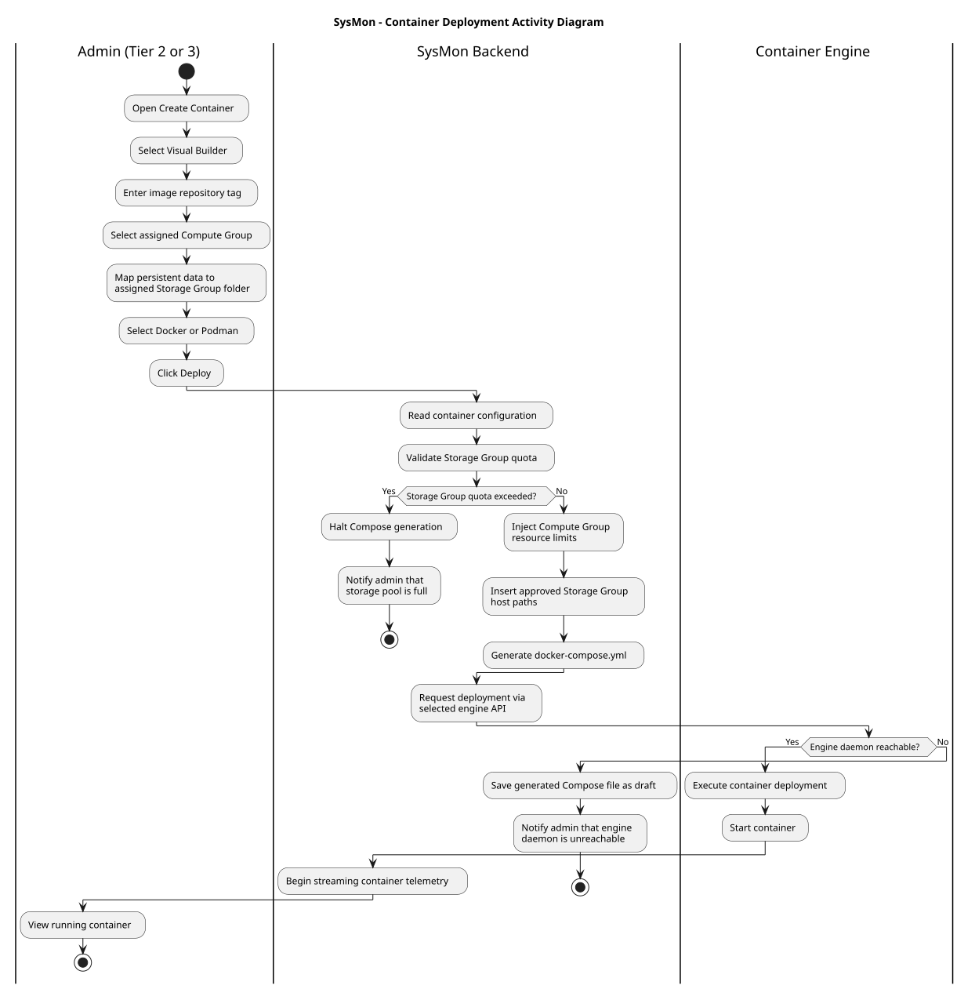
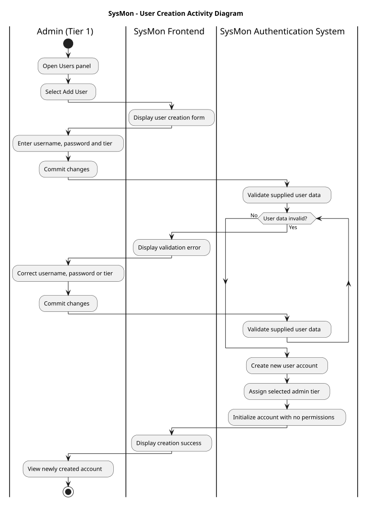
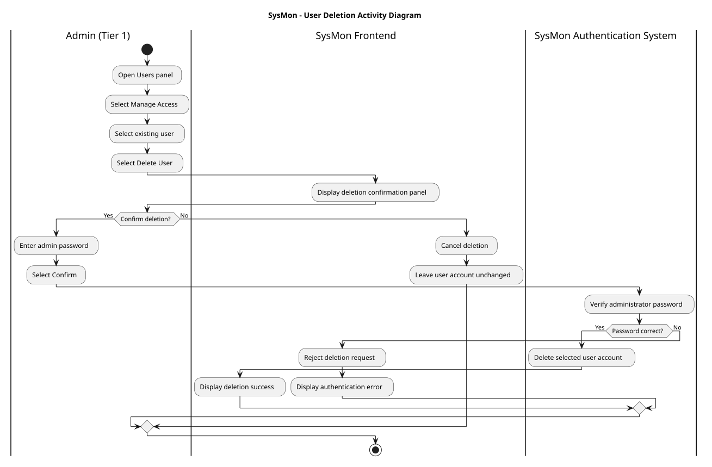
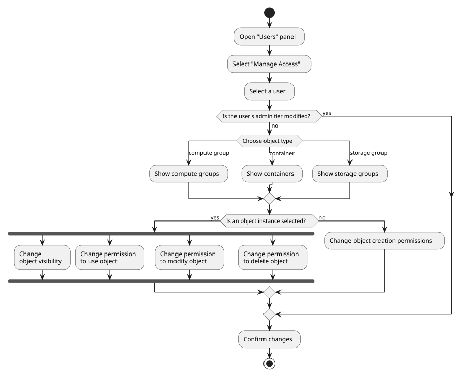
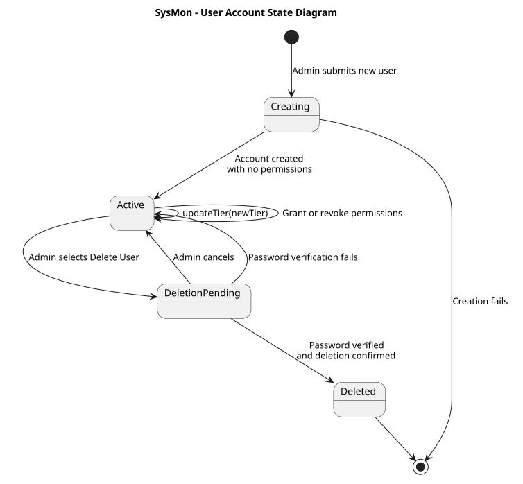
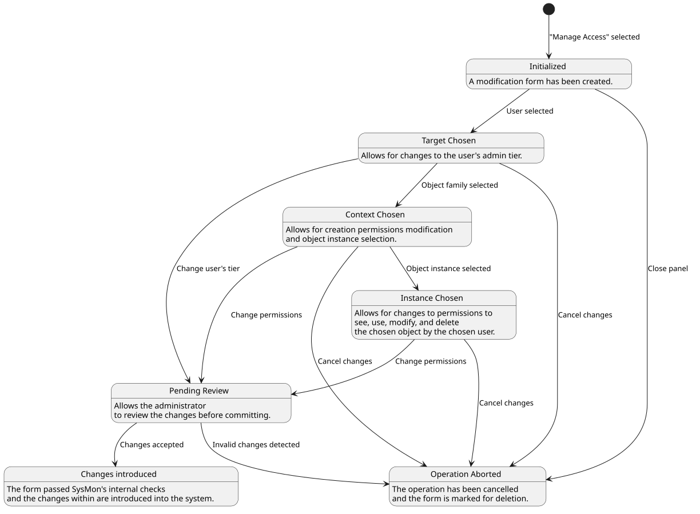

# System states and activities

# 1. User stories

# 2. Activity diagrams

## 2.1. Container deployment

## 2.2. User creation

## 2.3. User deletion

## 2.4. Managing user access

# 3. State diagrams

## 3.1. User account lifecycle

## 3.2. Managing user access

