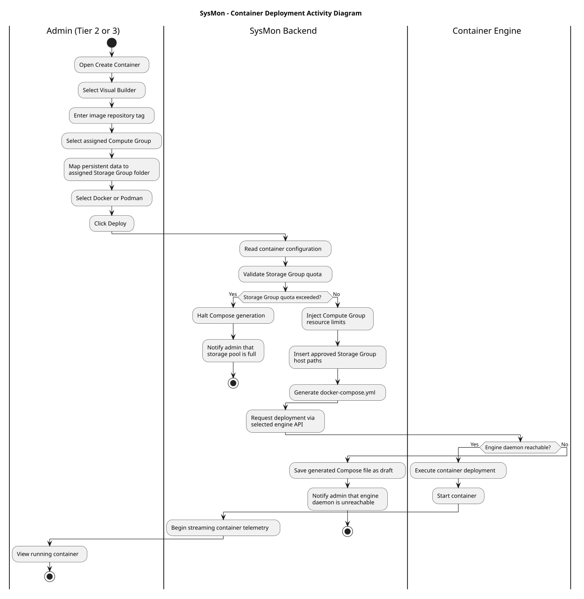
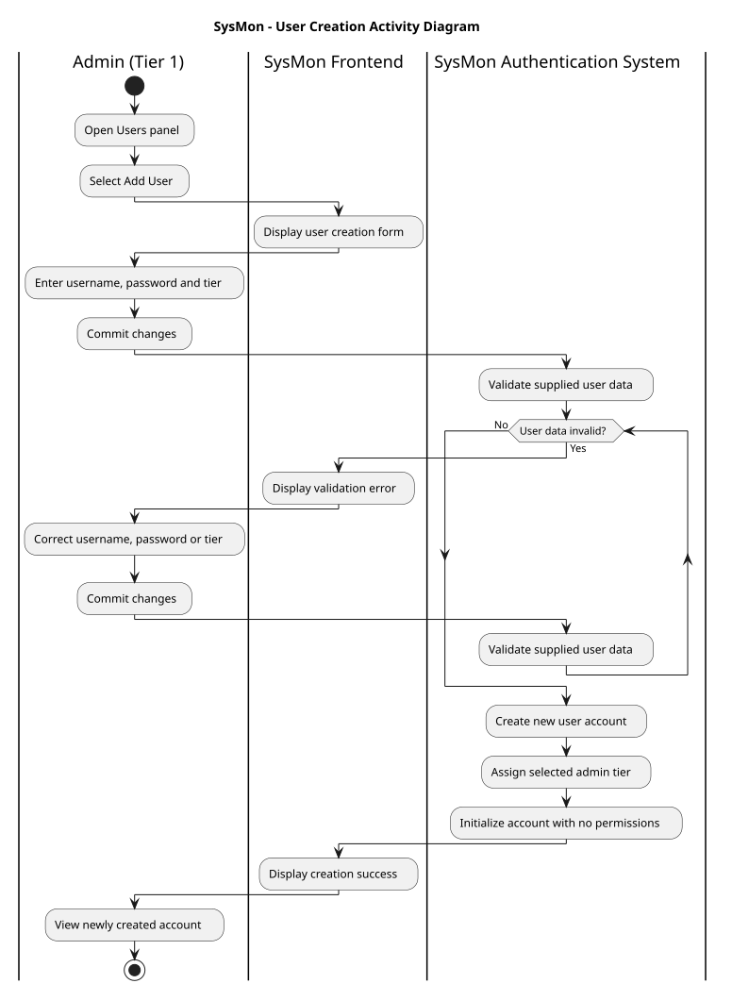
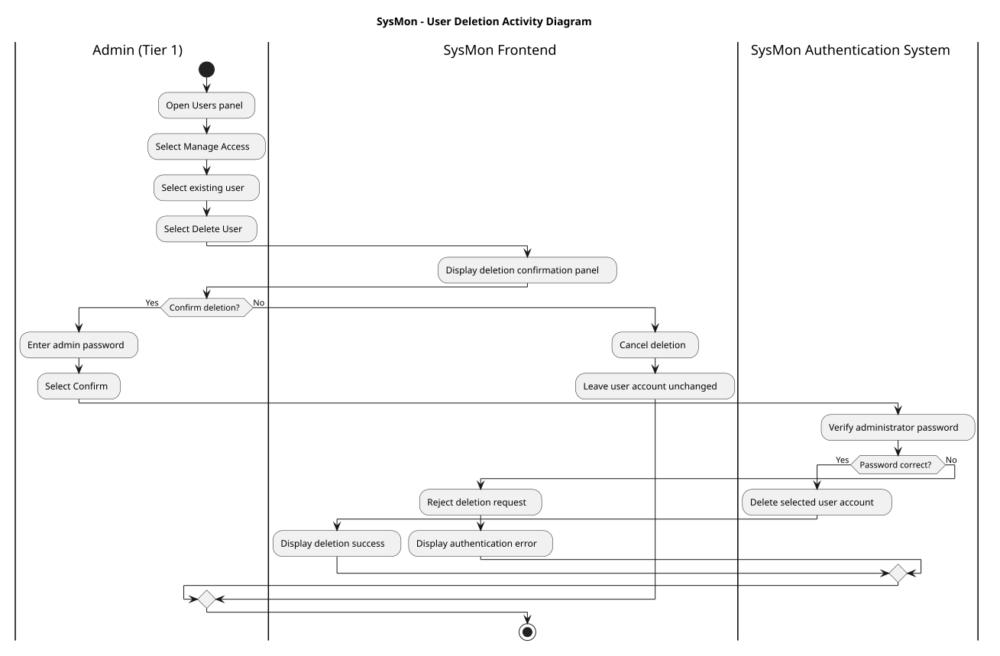
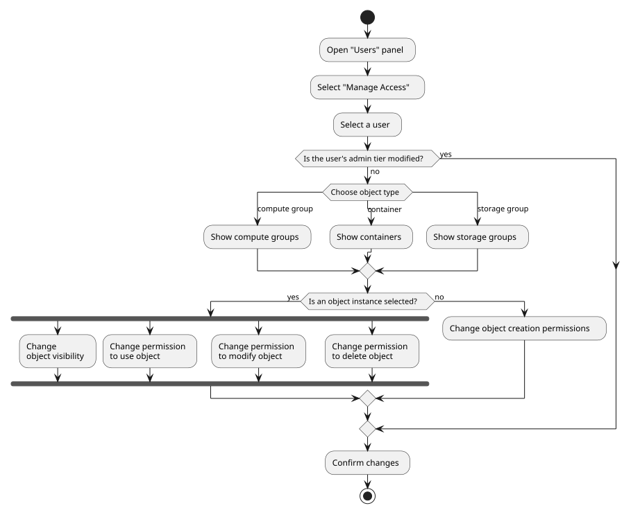
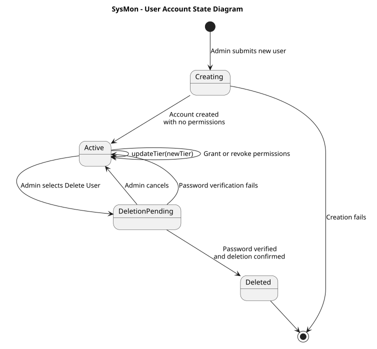
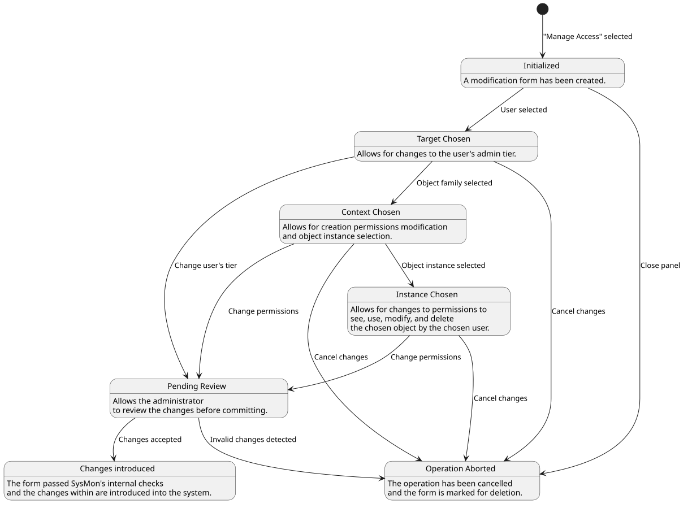

# System states and activities

# 1. User stories

Each user story from checkpoint 1 is shown with its reverse side: acceptance criteria, edge cases, open questions, estimation notes, constraints and dependencies.

## 1.1. US1 (Resource Governance)

**Front:** As a Tier 1 admin, I want to create a "Basic Compute Group" that restricts deployments to 2 CPU cores and 4GB of RAM, so that lower-tier users cannot accidentally exhaust the host server's resources.

| Field | Description |
| --- | --- |
| **Priority** | Must have (Functional Compute Groups) |
| **Estimate** | 5 story points |
| **Related Use Cases** | 5. Creating Compute and Storage Groups, 6. Deleting Compute and Storage Groups, 7. Managing Existing Compute and Storage Groups |
| **Related Activities** | 2.1. Container deployment (Compute Group limits are injected as `deploy.resources`) |
| **Depends On** | Tier-based authentication (Tier 1 or 2 may manage groups) |

### Acceptance Criteria

1. The admin opens "Manage Groups", selects "Create New Compute Group" and specifies the name, CPU, RAM and GPU restrictions.
2. For 2 CPU cores and 4GB of RAM the group is created and listed as "Basic Compute Group".
3. A container deployed with this group has the CPU and RAM limits in its generated Compose file, enforced at the cgroup level.
4. Users of a lower tier cannot raise, edit or bypass the limits.

### Edge Cases

- Values exceeding the hardware capabilities of the host are rejected and the admin returns to the form (no group is created).
- A group that is still in use cannot be deleted.
- The admin cancels the creation: no group is created.

### Open Questions

- Should running containers be restarted automatically when the limits of their group are modified?
- What are the minimum allowed values for CPU and RAM?

## 1.2. US2 (Storage Quotas)

**Front:** As a Tier 1 admin, I want to create a Storage Group with a 50GB quota, so that users deploying applications via the visual builder can only map volumes to this restricted folder without filling up the host system's root drive.

| Field | Description |
| --- | --- |
| **Priority** | Must have (Functional Storage Groups) |
| **Estimate** | 5 story points |
| **Related Use Cases** | 1. Visual Configuration and Deployment with Resource Limits, 5. Creating Compute and Storage Groups, 6. Deleting Compute and Storage Groups, 7. Managing Existing Compute and Storage Groups |
| **Related Activities** | 2.1. Container deployment (storage quota validation, insertion of approved host paths) |
| **Depends On** | Backend host-level filesystem management, Tier-based authentication |

### Acceptance Criteria

1. The admin selects "Create New Storage Group" and specifies the name and the size quota (here 50GB).
2. The system creates a bounded host directory for the group and records its quota.
3. In the visual builder, persistent data can only be mapped to folders inside the chosen Storage Group.

### Edge Cases

- A quota exceeding the free space of the host is rejected and the admin returns to the form.
- A host path outside the Storage Group is refused.
- When the quota is exhausted, Compose generation is halted and the admin is notified that the storage pool is full.
- A group that is still in use cannot be deleted.

### Open Questions

- Which mechanism enforces the quota (filesystem quotas, sized volumes or periodic usage checks)?
- What happens when a quota is lowered below the current usage?

## 1.3. US3 (Visual Deployment)

**Front:** As a Tier 3 (newer) admin, I want to visually attach a Docker image and select a pre-approved Compute Group and Storage Group, so that the system automatically generates a compliant Compose file.

| Field | Description |
| --- | --- |
| **Priority** | Should have (Container creation through Compose files) |
| **Estimate** | 8 story points |
| **Related Use Cases** | 1. Visual Configuration and Deployment with Resource Limits |
| **Related Activities** | 2.1. Container deployment |
| **Depends On** | US1, US2 (the groups must exist), Docker or Podman engine |

### Acceptance Criteria

1. The admin opens "Create Container", selects "Visual Builder" and enters the image repository tag.
2. Only the Compute Groups and Storage Groups assigned to the admin can be selected.
3. The admin selects the target engine (Docker or Podman) and clicks Deploy.
4. The backend generates a Compose file containing the resource limits of the Compute Group and only the approved host paths of the Storage Group.
5. After a successful deployment the container is running and telemetry streaming begins.

### Edge Cases

- If the Storage Group quota is exceeded, generation is halted and the admin is notified.
- If the engine daemon is unreachable, the generated Compose file is saved as a draft and the admin is notified.
- The admin cannot change the generated limits to exceed those of the group.

### Open Questions

- How are non-existent or private images handled?
- Should Podman deployments produce the same Compose file as Docker deployments?

## 1.4. US4 (Advanced Deployment)

**Front:** As a Tier 1 admin, I want to paste my existing custom `docker-compose.yml` files directly into the system to easily migrate existing complex homelab stacks.

| Field | Description |
| --- | --- |
| **Priority** | Should have (Container creation through Compose files) |
| **Estimate** | 5 story points |
| **Related Use Cases** | 1. Visual Configuration and Deployment with Resource Limits (alternative to the Visual Builder) |
| **Related Activities** | 2.1. Container deployment |
| **Depends On** | Docker or Podman engine integration, Tier 1 permissions |

### Acceptance Criteria

1. The admin opens "Create Container", chooses the Compose file option and pastes (or uploads) the file contents.
2. Stacks with multiple services, networks and volumes are supported.
3. If a Compute Group or Storage Group is attached, its limits are applied to the services.
4. After deployment the containers of the stack appear in the container list and begin streaming telemetry.

### Edge Cases

- Syntactically invalid YAML is rejected with the location of the error and nothing is deployed.
- Host paths outside the attached Storage Group are rejected.
- If the engine daemon is unreachable, the pasted file is saved as a draft.

### Open Questions

- Can a Tier 1 admin deploy a stack without any group (unrestricted)?
- How are secrets and `.env` files referenced by the Compose file handled?
# 2. Activity diagrams

## 2.1. Container deployment

## 2.2. User creation

## 2.3. User deletion

## 2.4. Managing user access

# 3. State diagrams

## 3.1. User account lifecycle

## 3.2. Managing user access

