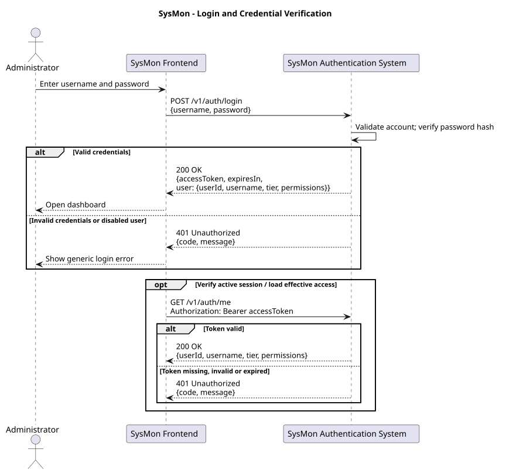
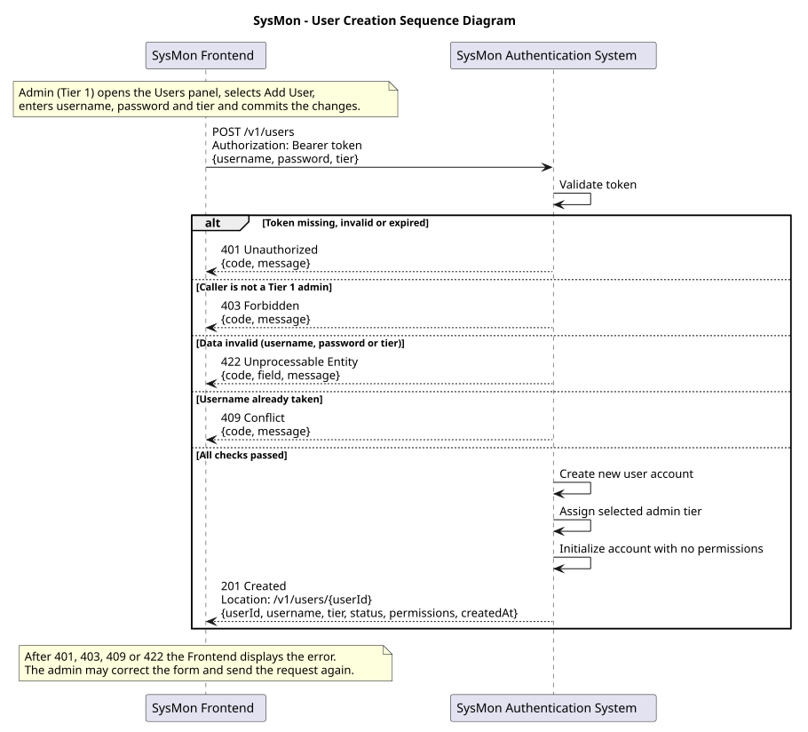
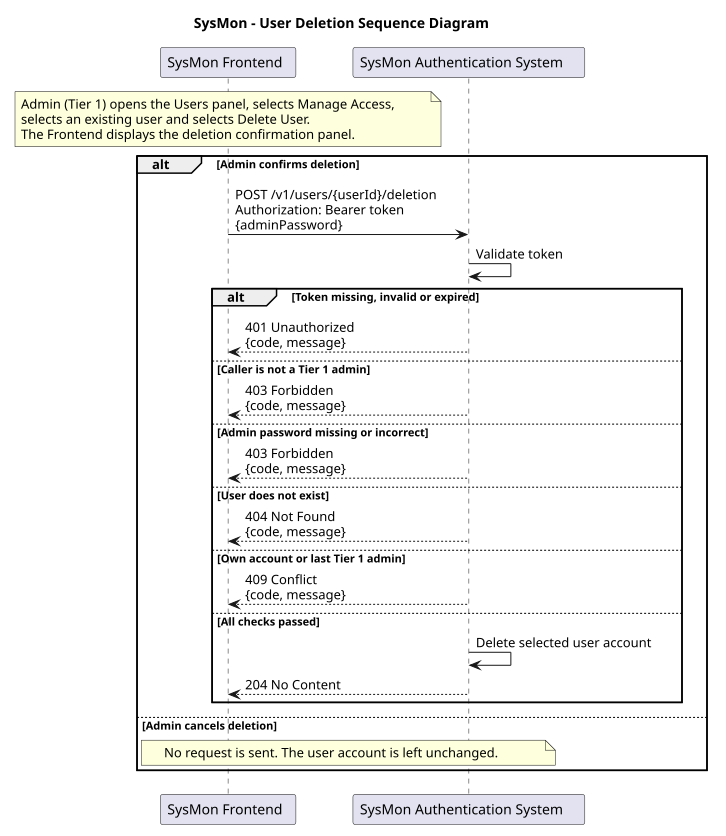
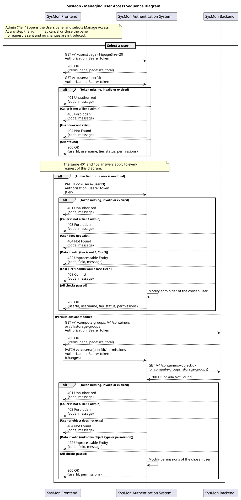
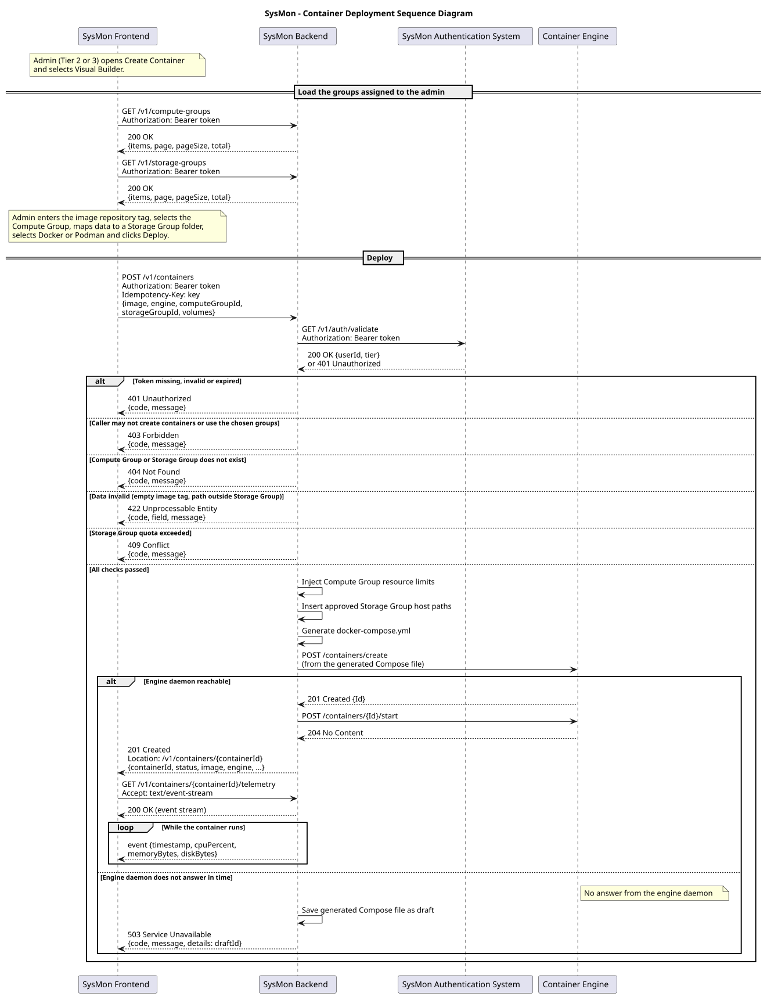
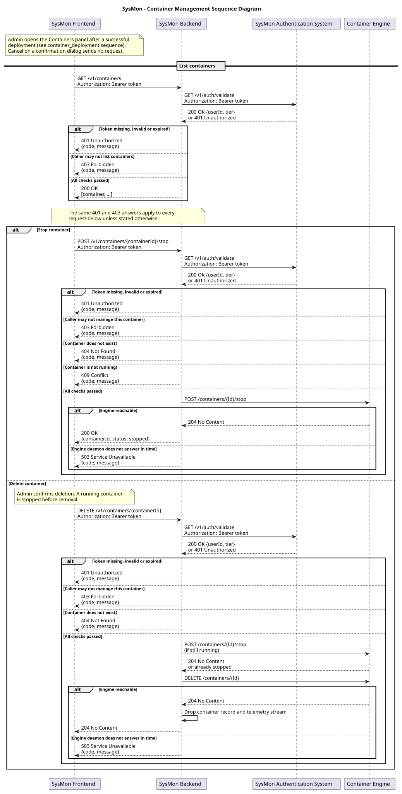
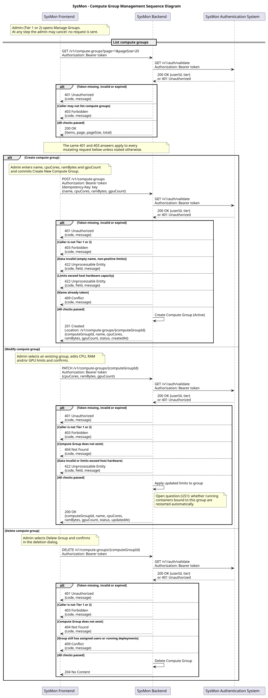
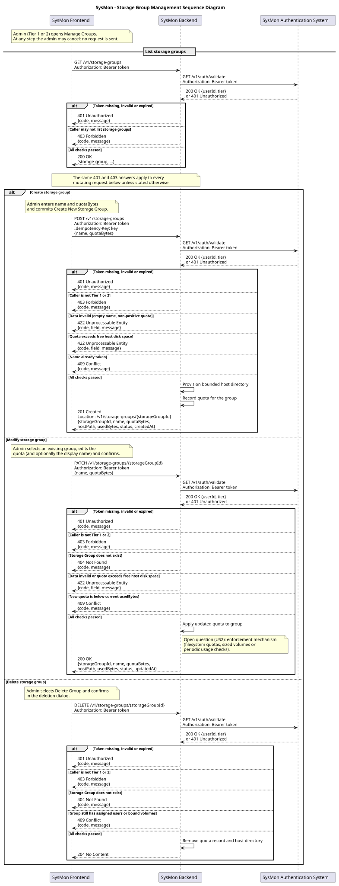
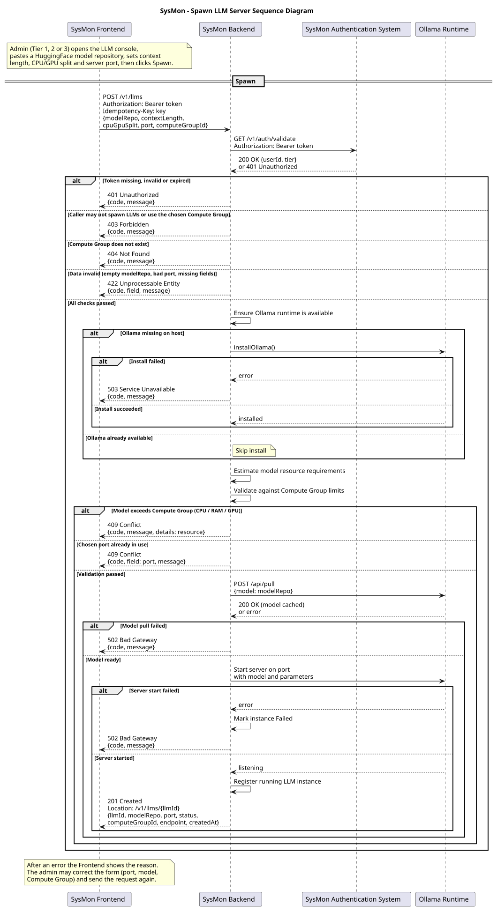
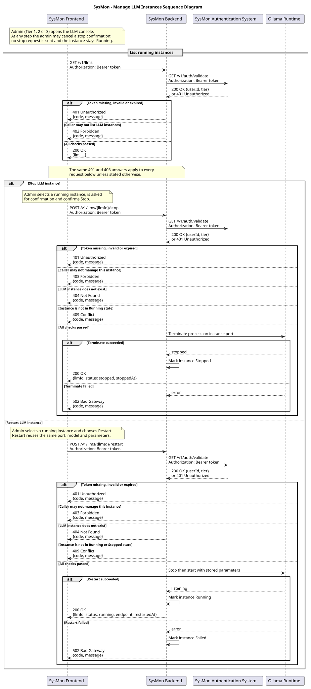

# System communication — sequence diagrams and message shapes

This checkpoint describes how SysMon components talk to each other on the standard and abnormal paths. Communication uses a **REST API** over HTTP (CRUD style). Identification and authorization use a **Bearer token**; successful validation returns `{userId, tier}`. Error bodies use `{code, message}` and optionally `{field}` or `{details}`.

Sequence diagrams cover the inter-component surface for users, containers, compute groups, storage groups, and LLM orchestration. Message fields are shown inline on the diagrams and summarized below. Where an OpenAPI draft exists, the diagrams follow that contract (in particular, **list endpoints return a JSON array** of resources, not a paginated envelope).

## OpenAPI drafts

Formal message schemas live under [`OpenAPI_yaml/`](./OpenAPI_yaml/):

| File | Coverage |
| --- | --- |
| `components.yaml` | Shared schemas (user, compute-group, storage-group, errors, BearerAuth) |
| `users.yaml` | `/v1/users` and related paths |
| `compute-groups.yaml` | `/v1/compute-groups` |
| `storage-groups.yaml` | `/v1/storage-groups` |

**Note:** OpenAPI YAML is currently written only for **users**, **compute groups**, and **storage groups** (plus shared `components`). YAML for **containers**, **auth**, and **LLMs** is not drafted yet; those resources will use the **same structure and conventions** as the existing files (path fragments, BearerAuth, array list responses, shared error schemas).

## Components

| Component | Role |
| --- | --- |
| **SysMon Frontend** | UI; initiates all admin operations |
| **SysMon Backend** | Orchestration, groups, containers, LLM, host filesystem |
| **SysMon Authentication System** | Token validation, user CRUD, tiers, permissions |
| **Container Engine** | Docker or Podman daemon (create / start / stop / delete) |
| **Ollama Runtime** | Local LLM install, model pull, serve / terminate |

## Shared identification and authorization

| Data | Meaning |
| --- | --- |
| `Authorization: Bearer <token>` | Present on every authenticated request |
| `userId` | Stable user identifier |
| `tier` | Admin tier `1`, `2` or `3` |
| `computeGroupId` / `storageGroupId` / `containerId` / `llmId` | Resource identifiers used for authz and routing |
| `Idempotency-Key` | Optional header on create (`POST`) to avoid duplicate side effects |
| Error `{code, message[, field][, details]}` | Abnormal path payload |

---

# Sequence diagrams

## 1. User authorization

Happy path: `200` (credentials/token valid). Abnormal: `401` (unauthorized).

## 2. User creation

Happy path: Tier 1 admin `POST /v1/users`. Abnormal: `401`, `403`, `422`, `409` (username taken).

## 3. User deletion

Happy path: Tier 1 admin `POST /v1/users/{userId}/deletion` with `{adminPassword}`. Abnormal: cancel, `401`, `403`, `404`, `409` (self or last Tier 1).

## 4. Managing user access

Happy path: list/get user, then `PATCH` tier or permissions (Backend validates object IDs for compute groups, storage groups, containers). Abnormal: cancel, `401`, `403`, `404`, `422`, `409`.

## 5. Container deployment

Happy path: load groups → `POST /v1/containers` → Auth validate → Compose generation → Engine create/start → SSE telemetry. Abnormal: `401`, `403`, `404`, `422`, `409` (quota), `503` (engine timeout, draft saved).

## 6. Container management

Happy path: list, stop (`POST .../stop`), delete (`DELETE`). Abnormal: `401`, `403`, `404`, `409` (not running), `503` (engine unreachable). Complements deployment for the full container lifecycle.

## 7. Compute group management

Happy path: list, create (`POST /v1/compute-groups` with `{name, cpuCores, ramBytes, gpuCount}`), modify (`PATCH`), delete (`DELETE`). Abnormal: invalid / host-exceeding limits (`422`), name conflict (`409`), delete while in use (`409`), auth failures.

## 8. Storage group management

Happy path: list, create (`POST /v1/storage-groups` with `{name, quotaBytes}` → host path + quota), modify (`PATCH`), delete (`DELETE`). Abnormal: quota vs free disk (`422`), quota below `usedBytes` (`409`), delete while in use (`409`), auth failures.

## 9. Spawn LLM server

Happy path: `POST /v1/llms` → ensure/install Ollama → validate against Compute Group → pull model → start → `201` with `{llmId, endpoint, ...}`. Abnormal: authz, missing group, invalid body, install failure (`503`), Compute Group / port conflict (`409`), pull or start failure (`502`).

## 10. Manage LLM instances

Happy path: list, stop (`POST /v1/llms/{llmId}/stop`), restart (`POST .../restart`). Abnormal: cancel stop (no request), wrong state (`409`), terminate/restart failure (`502`), auth failures.

---

# Message shape summary (inline contracts)

Aligned with the OpenAPI drafts where those exist. List `GET`s return a **JSON array**. Create/update fields are shown as JSON bodies on the diagrams (same fields as in the YAML path parameters).

### Auth / users

| Exchange | Shape |
| --- | --- |
| List users | `GET /v1/users` → `[user, ...]` |
| Get user | `GET /v1/users/{userId}` → `user` |
| Validate | `GET /v1/auth/validate` → `{userId, tier}` (YAML for auth still pending; same style as other drafts) |
| Create user | `POST /v1/users` → `user` (`201`) |
| Delete user | `POST /v1/users/{userId}/deletion` → `204` |
| Patch tier | `PATCH /v1/users/{userId}` → `user` |
| Patch permissions | `PATCH /v1/users/{userId}/permissions` → `{userId, permissions}` |

### Compute groups

| Exchange | Shape |
| --- | --- |
| List | `GET /v1/compute-groups` → `[compute-group, ...]` |
| Create | `POST /v1/compute-groups` → `compute-group` (`201`) |
| Modify | `PATCH /v1/compute-groups/{computeGroupId}` → `compute-group` |
| Delete | `DELETE` → `204` or `409` if still assigned / deployed |

### Storage groups

| Exchange | Shape |
| --- | --- |
| List | `GET /v1/storage-groups` → `[storage-group, ...]` |
| Create | `POST /v1/storage-groups` → `storage-group` (`201`) |
| Modify | `PATCH /v1/storage-groups/{storageGroupId}` → `storage-group` |
| Delete | `DELETE` → `204` or `409` if still in use |

### Containers (YAML pending — same structure as above)

| Exchange | Shape |
| --- | --- |
| List | `GET /v1/containers` → `[container, ...]` |
| Deploy | `POST /v1/containers` → container (`201`) |
| Telemetry (SSE) | event `{timestamp, cpuPercent, memoryBytes, diskBytes}` |
| Stop / delete | status update or `204`; Engine uses `/containers/{Id}/stop` and `DELETE /containers/{Id}` |

### LLMs (YAML pending — same structure as above)

| Exchange | Shape |
| --- | --- |
| List | `GET /v1/llms` → `[llm, ...]` |
| Spawn | `POST /v1/llms` → llm (`201`) |
| Stop / restart | status update or `502` if Ollama fails |

---

# Coverage notes

| Area | Standard path | Key abnormal paths |
| --- | --- | --- |
| Users | create, delete, manage access | auth, validation, conflicts |
| Containers | deploy + telemetry, list/stop/delete | quota, engine timeout, not running |
| Compute groups | CRUD | host limits, in-use delete |
| Storage groups | CRUD | free disk, quota below usage, in-use delete |
| LLM | spawn, list/stop/restart | install fail, CG exceed, port in use, start/stop fail |
